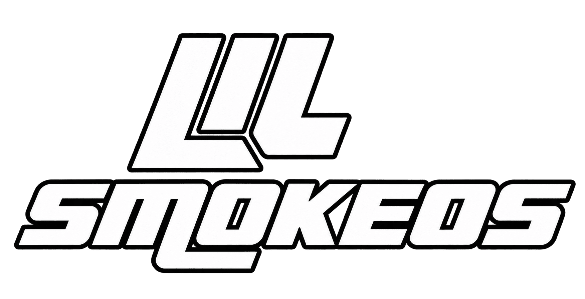

<p align="center">
  <a href="https://ko-fi.com/josepilas" target="_blank" rel="noopener noreferrer">
    
  </a>
</p>

# LilSmokeOS



**Alpha-0.0.1**. Created and led by **José Pilas**.

LilSmokeOS is a Buildroot external tree and controller-first Linux interface
for constrained MIPS devices. The authored Alpha source is public under
**Mozilla Public License 2.0 (MPL-2.0)**, including the C++ interface, board
adapters, shell services, Buildroot integration, scripts and application SDK/API.
Upstream components and modifications to upstream files retain their own terms
and source/notice obligations. This is not blanket MPL relicensing.
Daedalus-LilSmoke and the custom Mupen-LilSmoke experiments are excluded;
existing generic N64/Mupen64Plus support is not removed.

## Release Status

The complete authored Alpha source is available in this repository, and the
image and source ZIP are distributed through [Alpha-0.0.1 Releases](https://github.com/josepilas/LilSmokeOS/releases/tag/Alpha-0.0.1).
See the [Alpha source inventory and limits](docs/alpha-0.0.1-source.md).
The source archive contains no ROM, BIOS, stock firmware export or private game build.

The Alpha image is **1,880,096,768 bytes**,
SHA-256 `1d5c30b0635ca7577ca209c304320c35723eb5f48ad6168b71a3f9261fa16d12`.
Both FAT filesystem checks passed. LILOS is 1 GiB and the initial LILROMS is
768 MiB, growable within the prepared 128 GiB capacity. Physical Alpha cold
boot remains unverified; image/VM results are reported independently.

The experimental [Pre-Alpha-0.0.1 image](https://github.com/josepilas/LilSmokeOS/releases/tag/Pre-Alpha-0.0.1)
is published. It is **not certified universal firmware or complete redistribution
clearance**. Owner-imported boot dependencies and complete third-party source,
build/relinking and resource notices still have documented audit gaps.
Private SM64 packages embed extracted game data and a source-only renderer and
must not be attached to a release. See [licensing](LICENSE_POLICY.md).

The asset-free [SM64-LilSmoke Pre-Alpha-0.0.2](https://github.com/josepilas/SM64-LilSmoke/releases/tag/Pre-Alpha-0.0.2)
is published separately with public adaptation source and a `.lilpck` release.
It prepares the original game locally from the user's supported ROM in `original/`;
no ROM or pre-cooked original-game runtime is distributed.

The physically tested device is the owner's **SEGAM-M8-V6.0**, stock firmware
**V1.0.0 2024-12-05**, HCSEMI MIPS/128 MB lineage. Other M8, SF3000 and GB350
boards are not certified by that result. Never select firmware solely by a
console's marketing name.

## Changes Since Pre-Alpha

Alpha includes the updated device runtime, not only the public-source release:

- Expanded theme layouts, carousel/storyboard animation and transitions;
  corrected fixed backgrounds and themed shutdown, with software-rendering,
  frame-pacing and cache optimizations.
- Branded boot logo kept visible during loading, with progress/percentage;
  faster cached returns, manual scanning, Y search, held-R2 fast scrolling,
  Favorites and Recently Played.
- RetroArch menu/performance/save-state repairs, PCSX4ALL state persistence,
  RK707 mode/analog/reconnect fixes and safer shutdown feedback.
- Separate copy-and-play TreeFrog Ports compatibility, improved port controls
  and exit handling; optional browser conversion into LilSmoke Applications.
- Shell Terminal, FFmpeg and media startup/audio/presentation improvements.
- Public Applications SDK/API and Studio, Port Converter, and full OS source.

Read the [full Alpha changelog](docs/alpha-0.0.1/RELEASE-NOTES.md) for the
complete feature/fix breakdown, inherited features, known limits and validation.
Not every theme, port, game or codec is guaranteed to run at full speed.

## Guides

- [Alpha release and installation](docs/alpha-0.0.1/README.md)
- [Alpha changes since Pre-Alpha](docs/alpha-0.0.1/RELEASE-NOTES.md)
- [Current user manual](docs/alpha-0.0.1/USER-GUIDE.md)
- [Historical Pre-Alpha guide](docs/pre-alpha-0.0.1/README.md)
- [Troubleshooting](docs/pre-alpha-0.0.1/troubleshooting.md)
- [Developer guides](docs/developer/README.md)
- [Applications SDK/API](docs/lilsmoke-applications-sdk.md)
- [Credits](CREDITS.md), [third-party notices](THIRD_PARTY_NOTICES.md)

Two visible partitions are used: **LILOS (FAT32)** and **LILROMS (FAT32/exFAT)**.
The tested spare uses FAT32 for both. LILROMS stores games, themes, applications
and user data and is the only partition eligible for LILDRIVE export.
Use Settings -> Power Off and wait for the success message/black screen before
unplugging the M8. A black TV alone does not prove that storage closed safely.

## Experience

LilSmokeUI integrates controller input, theme import, ROM scanning, per-system
emulator selection, LilSmoke Explorer, music/video/photos and the independent
Applications `.lilpck` installer. Applications bundle their runtimes and can
declare `open_core` associations. RetroArch and adapted OpenDingux applications
are integrated; PCSX4ALL is an independent application.

Owner tests confirm SNES/GBA/Mega Drive/PCSX4ALL gameplay, M8 sound, emulator
menu/exit combos, shutdown and RK707 D/PS/X-input. This is not a guarantee for
every game, controller, codec or board. Networking, Bluetooth, USB gadget modes
and ZRAM depend on the actual kernel/hardware. N64/3D and HD video are CPU-limited.

The PC Device Adapter reads a stock-folder backup, creates a private firmware
export and applies a reviewed matching adaptation with verified backup/recovery.
Its initial install profile matches only the tested M8 lineage; unknown variants
are inspection/export-only. Windows has an executable; Linux/macOS launchers
require Python 3.10+ and Tk. A folder cannot supply an incompatible boot gap.

## Architecture

```text
UI / Explorer / Applications / Media
          | low-memory process handoff
RetroArch / adapted OpenDingux / independent apps
          | software SDL / DirectFB / native M8 adapters
musl userspace + BusyBox services
          | board-specific boot/kernel contracts
Validated MIPS board, or Malta/QEMU development fixture
```

No GPU/GL/GLES/Vulkan is assumed. M8 framebuffer scaling is a 2D presentation
facility, not hardware 3D. QEMU tests ABI/control workflows and bounded memory;
it does not reproduce HC16xx cycle timing or audible auddec.

## Development

The [LilSmoke SDK/API and Studio repository](https://github.com/josepilas/LilSmoke-SDK)
provides standalone developer source and [SDK/Studio releases](https://github.com/josepilas/LilSmoke-SDK/releases).
The [LilSmoke Port Converter](https://github.com/josepilas/LilSmoke-Port-Converter)
has separate [source](https://github.com/josepilas/LilSmoke-Port-Converter/tree/source)
and [browser distribution](https://github.com/josepilas/LilSmoke-Port-Converter/tree/dist)
branches, a [0.2.0 release](https://github.com/josepilas/LilSmoke-Port-Converter/releases/tag/0.2.0)
and the [hosted converter](https://josepilas.github.io/LilSmoke-Port-Converter/).
These repositories are published independently of the OS image;
the SDK and converter source also remain in this OS external tree.

The [Applications SDK](tools/lilsmoke-sdk/README.md) provides a graphical SDL2
starter, host preview, MIPS build profile and `.lilpck` packaging. It is separate
MPL-2.0 original developer tooling; a matching device toolchain is not bundled.
Packages discover their single root `.sh` by extension, not a fixed `run.sh`
name. See its portable guide for prerequisites and tested limits.

Use the documented pinned Buildroot/SDK and board workflow, not an arbitrary
upstream kernel or ARM image. QEMU is a development fixture:

```sh
make BR2_EXTERNAL=/path/to/lilsmoke-os lilsmoke_qemu_mipsel_defconfig
make
/path/to/lilsmoke-os/scripts/run-qemu.sh output/images
```

Read [the publishing checklist](docs/release-preparation.md) before staging.
Never `git add .` from this development workspace: stock exports, private
packages, ROMs, build outputs and captures are outside release scope.
Repository: [josepilas/LilSmokeOS](https://github.com/josepilas/LilSmokeOS).
The older Pre-Alpha image and its checksum are historical artifacts, not the
Alpha image. Public authored source does not establish that all firmware,
game engines or artwork can be redistributed, or reproduce that old image
without separately obtained dependencies. Read each artifact's exact limits.
